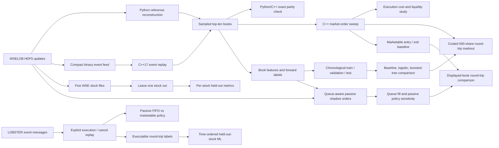

# MOSAIC

**Market Order-book Simulation, Analytics, and C++ Integration**

[](https://github.com/ArnabIITP/mosaic-orderbook/actions/workflows/ci.yml)
[](LICENSE)

MOSAIC started as a price-time-priority order-book simulator. It now includes a Python reference, a C++17 replay engine, historical execution studies, and a multi-stock direction benchmark. The research asks whether displayed liquidity and volatility are associated with execution cost, and whether order-book features transfer across instruments.

## Quick demo

Run `python demo.py` with Python 3.10+ and no downloaded data. It shows a passive order joining behind a FIFO queue, advancing on trades, not on cancellations, and a marketable-order sweep baseline. This is a deterministic synthetic illustration of the simulator, not a historical result.

## Findings


- **Unseen-stock transfer:** From 85.8 million updates, 817,626 usable sampled books were reconstructed across five WSE stocks. Train on four stocks’ early 2017 dates and test on a fifth’s final 38 dates, with the held-out stock excluded from training. The boosted tree beats the training-prior baseline on all five names by 1.58–3.95 balanced-accuracy points; every 95% date-bootstrap interval excludes zero. Its log loss is also lower on all five. Mean lift is 2.77 points. This is historical cross-stock transfer within one exchange and one year, not evidence of a tradeable edge. [Protocol and per-stock results](results/multi_stock_ml_study.md)
- **Walk-forward and ablation:** Across five expanding test blocks with five-session embargoes, the PEKAO boosted model reaches 35.4% balanced accuracy versus 33.3% for the prior baseline (date-bootstrap lift interval +1.48 to +2.63 points). Removing book-state features leaves the pooled score essentially unchanged; removing recent returns lowers it to 34.0%. In this setup, the measured lift is not evidence that book-state features add value beyond recent returns. [Fold results and ablations](results/walk_forward_study.md)
- **Execution-policy comparison:** On the same 383 held-out calls, a 500-share passive order filled at least partially on 23.0% of calls under the optimistic assumption that same-price WSE `M` decreases represent execution. After sweeping the displayed opposite-side book at the target and charging 0.1 bp maker entry plus 1 bp taker exit, the mean was **−0.60 bps per requested notional** (date-bootstrap 95% interval −0.97 to −0.26). Conditional midpoint markout had been +2.57 bps, showing why midpoint marks alone overstate execution quality. An immediate marketable entry and exit at 1 bp per side averaged **−17.14 bps** (95% interval −19.20 to −16.18). Treating ambiguous `M` decreases as cancellations produced no passive fills. These are displayed-depth diagnostics, not strategy returns; both the passive fill interpretation and static-book assumptions are material limitations. [Policy comparison and sensitivity](results/queue_execution_sensitivity.md)
- **Explicit-execution policy replay:** The included LOBSTER messages identify visible executions and cancellations. On five stocks from one 2012 session, a fixed imbalance rule generated 332 matched, non-overlapping intents. The best-quote passive order had **zero fills** at a 250 ms working time; a 2-second posting scenario also had zero. A marketable 100-share entry/exit baseline filled 99.1% of requested entry size and ended at **−3.23 bps per round-trip turnover**, after illustrative 1 bp/side fees. This makes the queue-versus-immediacy tradeoff measurable, but one day cannot establish a general execution result. [Event-driven policy study](results/lobster_queue_backtest.md) · [2-second posting sensitivity](results/lobster_queue_backtest_2s.md)
- **Executable-target ML:** A five-fold held-out-stock, time-ordered benchmark asks whether book and recent order flow can identify a fully displayed-depth-fillable 100-share round trip with positive net return after fees. In the 1,081 held-out eligible samples, only 21 labels were directional and 1,060 were flat. The boosted model’s balanced accuracy was 0.331, near the 0.333 prior baseline; its six non-overlapping predicted trades averaged −4.05 bps. The logistic model selected one trade, which made +0.59 bps, far too few to support an edge claim. Removing flow changed the boosted score negligibly (0.331 to 0.330). Some held-out stocks have very few eligible samples. This is an exploratory one-day 2012 study, not multi-date validation. [Protocol, fold results, and limitations](results/lobster_executable_ml_study.md)
- **Multi-session costed cross-stock test:** A new WSELOB study reconstructs 85.8 million updates into 621,114 fully displayed-depth-fillable 500-share round-trip examples across five stocks and 250 sessions. Models train on four stocks’ first 175 sessions, reserve the next 37, and test on the unseen fifth stock’s final 38 sessions. Balanced accuracy is essentially at the 0.333 prior baseline. A sequential model-selected policy generated only 21 non-overlapping hypothetical round trips; the boosted model averaged **−14.97 bps/trip**, with a session-bootstrap 95% interval of **−20.63 to −3.94 bps** across 16 active test sessions. This is negative evidence: the tested features and model do not identify a robust after-cost cross-stock edge under this simulator. These are immediate displayed-book sweeps with 1 bp/side assumed fees, not observed fills; WSELOB has no independent trade-print stream here, so passive queue fills remain unvalidated. [Study protocol, per-stock outcomes, and limitations](results/multistock_executable_study.md) · [Machine-readable metrics and source hashes](results/multistock_executable_metrics.json)
- **C++ operation benchmark:** Seven 200,000-operation runs measured limit insert/cancel cycles, FIFO cancellation, single-level market matching, and top-five snapshots separately. Median throughputs were 3.82M, 8.87M, 5.44M, and 1.50M operations/s on the recorded Windows host. Sampled latency includes timer overhead and is not exchange latency; Linux hardware-counter profiling remains unavailable in this environment. [Benchmark settings and results](results/cpp_operation_benchmark.md)
- **Five-stock reconstruction check:** MOSAIC's top-ten books matched the dataset author's reference on 27,582 sampled states across nine dates, checking the first 100,000 events per date, with zero mismatches. This remains sampled rather than a full-year exhaustive comparison. [Validation summary](results/wselob_multi_stock_reference_validation.md) · [Machine-readable validation](results/wselob_multi_stock_reference_validation.json)
- **Within-stock direction:** On PEKAO’s final 38 trading dates, the boosted tree reached 35.0% balanced accuracy versus 33.3% for the training-prior baseline (7,364 snapshots). Lift was 1.68 points (95% date-bootstrap interval: 0.74–2.71). Log loss was slightly worse than baseline. [Methods and full results](results/ml_direction_study.md)
- **Horizon sensitivity:** The boosted tree’s balanced-accuracy lift was 1.68–2.64 points across requested 5–60 second horizons using identical date blocks. However, the 5- and 10-second targets cover only 13.3% and 21.8% of snapshots, and their log loss is worse than the baseline. The faster-horizon rows are selected toward busier intervals. [Full comparison](results/horizon_sensitivity_study.md)
- **After displayed-book costs:** In a held-out PEKAO 500-share round-trip markout, the boosted-tree calls averaged **−16.50 bps/trade** after the illustrative 1 bp fee per side. The prior-only baseline averaged −17.04 bps; their paired difference was +0.38 bps/date (95% interval −0.27 to +0.95), which includes zero. All tested rules had negative mean net markout. This does not show a profitable signal. [Cost-aware method and results](results/execution_aware_study.md)
- **Execution cost:** For hypothetical 500-share sweeps, high-volatility buckets had 3.53 bps more buy slippage and 3.67 bps more sell slippage than low-volatility buckets. Across 250 dates, the 95% intervals were 3.36–3.69 bps for buys and 3.49–3.84 bps for sells. The depth comparison was inconclusive: both thin-minus-deep intervals crossed zero. [WSELOB execution study](results/wselob_2017_execution_study.md)
- **Replay and mutation timing:** C++ processed 9.87 million updates at a median 1.95 million updates per second across seven Release runs (4.89–5.30 seconds, one warmup). All 96,465 sampled top-ten books matched the Python reconstruction. A separate pass sampled one mutation every 1,024 events: p50/p95/p99/p99.9 were 0.4/0.8/1.0/6.1 μs across 9,639 samples. This is an in-process mutation measurement on the recorded Windows host, not exchange or network latency. [Benchmark details](results/cpp_event_replay_benchmark.json)
- **Reconstruction:** The author's reference implementation matched all 425 sampled books checked across nine dates. The `agg_volume` audit found 1,617 differences in 9.80 million checks (0.0165%); the diagnostics are recorded in the report. [Validation record](results/wselob_2017_reference_validation.json)

## What the ML work asks

Using one year of PEKAO data from the Warsaw Stock Exchange, the benchmark asks whether information available in a sampled book can classify the next sampled mid-price as **down, unchanged, or up** around 60 seconds later. The target is the first same-session quote at or after 60 seconds, capped at 120 seconds; the realized delay has a 79.2-second median and 114.2-second 95th percentile.

The comparison includes a majority-class baseline, regularized logistic regression, and a fixed histogram gradient-boosting model. Features use spread, bid/ask depth imbalance and scale, trailing volatility, and backward-looking returns. Dates, not individual rows, are split chronologically: 175 training dates, 37 validation dates, and 38 final test dates. Imputation and scaling are fitted on the training dates.

The direction target is midpoint movement, not an executable return. The PEKAO cost-aware study uses displayed sweep prices and an explicit fee scenario, but assumes immediate full fills and ignores queue priority, intervening changes, and market impact. In the PEKAO sample, the median interval between 100-event snapshots is about 39.5 seconds; the requested 60-second target arrives after a median 79.2 seconds. The shorter-horizon sensitivity rows are selected toward faster activity. These data do not support a seconds-level HFT performance claim.

The multi-stock direction study uses the same fixed tree and linear baselines, not a Transformer. It tests transfer across five WSE stocks from one historical year. The original PEKAO execution-aware markout study remains PEKAO-only; it and the new multi-stock extension are offline diagnostics, not live orders or a portfolio backtest.

The new [multi-session executable-outcome study](results/multistock_executable_study.md) extends the model comparison to after-cost, hypothetical marketable round trips across five stocks. It uses a strict chronological holdout and sequential non-overlapping simulated positions, but its entry and exit are still immediate sweeps of sampled displayed depth. WSELOB does not supply a separate trade-print stream in this project, so this extension does not establish passive fill probability or queue position.

## What is in the project

- FIFO price-time-priority bid and ask queues; limit and market orders; cancellation; spread and depth; execution; inventory; realised and unrealised P&L.
- Python matching engine and C++17 implementation with randomized action-stream parity checks.
- WSELOB-2017 raw-feed reconstruction for add, modify, delete, retransmission, and day reset messages.
- C++ full-stream event replay and snapshot parity against the Python reconstruction.
- Historical execution sweeps at multiple order sizes, liquidity and volatility buckets, fee scenarios, delayed-book sensitivity, and date-level bootstrap intervals.
- A separate five-stock LOBSTER sample-day execution study and a controlled synthetic liquidity/volatility stress experiment.
- Time-ordered ML classification benchmark, baseline comparisons, held-out results, and date-clustered uncertainty intervals.
- Five-fold leave-one-stock-out WSE benchmark with date-based out-of-sample tests and equal total training weight per instrument.
- Cost-aware out-of-sample directional markouts using displayed-book entry and exit sweeps, with date-clustered uncertainty intervals.
- Multi-session, five-stock executable-outcome labels, strict chronological date blocks, leave-one-stock-out model evaluation, and sequential non-overlapping after-cost policy diagnostics.
- Event-driven passive FIFO shadow orders with order-ahead cancellations, partial fills, configurable arrival delay, fee assumptions, and markout sensitivity.
- Expanding-window walk-forward model comparisons with five-session embargoes and feature-family ablations.
- Fixed-date horizon sensitivity at 5, 10, 30, and 60 seconds, including row coverage and realized target delay.
- Sampled C++ book-mutation latency percentiles, reported separately from full replay throughput.
- Python and C++ checks plus GitHub Actions CI with AddressSanitizer and UndefinedBehaviorSanitizer on Linux.

## References

Cont, Kukanov, and Stoikov document a short-horizon relationship between order-flow imbalance, price changes, and market depth in [*The Price Impact of Order Book Events*](https://doi.org/10.1093/jjfinec/nbt003). For a richer neural-network approach to order-book prediction, see [DeepLOB](https://doi.org/10.1109/TSP.2019.2907260). MOSAIC tests a smaller feature-based benchmark on a different dataset.

## Architecture



## Reproduce the studies

### Requirements and local data

Python 3.10+, a C++17 compiler, and CMake are used. Raw market files and large row-level CSVs are intentionally not committed. The reports, compact metrics, and summary figure show the completed results without a data download. Reproducing the cross-stock study requires the five-stock WSELOB archive (about 1.3 GB); see [data/README.md](data/README.md).

```powershell
python -m pip install -r requirements-research.txt
```

### Run the WSELOB replay, execution study, and ML benchmark

```powershell
python -m unittest discover -v
python compare_cpp.py --events 10000 --seed 29
python replay_wselob_cpp.py --stride 100 --repetitions 7 --profile-every 1024
python analyze_wselob.py --stride 100 --fee-bps 1
python execution_aware_benchmark.py --fee-bps-per-side 1
python horizon_sensitivity.py
python multi_stock_ml_benchmark.py --data-dir data\wselob_2017 --stride 100
python validate_wselob_multi_stock.py
python ml_direction_benchmark.py
python walk_forward_benchmark.py
python execution_aware_benchmark.py --fee-bps-per-side 1
python queue_execution_study.py
python lobster_queue_backtest.py
python lobster_executable_ml.py
python multistock_executable_study.py --data-dir data\wselob_2017 --stride 100 --order-size 500 --fee-bps-per-side 1
python benchmark_cpp_operations.py --repetitions 200000 --runs 7
```

The WSELOB analysis writes the row-level observation CSV locally. The cost-aware, queue, and horizon scripts read it and write reports under `results/`; the execution-aware benchmark exports local held-out predictions with entry and target event indices. To reproduce queue sensitivities, run the default 500-share study, then rerun with `--order-size 100` and with `--latency-ms 100`, using separate output paths; finish with `python summarize_queue_execution.py`. The multi-stock command builds a cache under `build/` from the five raw HDF5 inputs. Markout observations overlap in time and are not strategy returns. For an independent sampled-book comparison against the data author’s reference code:

```powershell
python -m pip install -r requirements-validation.txt
python validate_wselob_reference.py --dates 20170102 20170215 20170330 20170518 20170703 20170816 20170928 20171113 20171229 --events-per-day 5000
```

### Build and check C++ directly

```sh
cmake -S . -B build-ci -DCMAKE_BUILD_TYPE=Debug -DLOB_ENABLE_SANITIZERS=ON
cmake --build build-ci --parallel
ctest --test-dir build-ci --output-on-failure
```

## Results and data files

- [WSELOB execution study](results/wselob_2017_execution_study.md)
- [ML direction benchmark](results/ml_direction_study.md)
- [Five-stock leave-one-out direction study](results/multi_stock_ml_study.md)
- [Five-stock machine-readable metrics](results/multi_stock_ml_metrics.json)
- [Five-stock reference validation](results/wselob_multi_stock_reference_validation.md)
- [Five-stock reference validation metrics (100,000 events per sampled date)](results/wselob_multi_stock_reference_validation.json)
- [Multi-session executable-outcome study](results/multistock_executable_study.md)
- [Multi-session executable-outcome metrics and source hashes](results/multistock_executable_metrics.json)
- [Execution-aware direction markout](results/execution_aware_study.md)
- [Execution-aware machine-readable metrics](results/execution_aware_metrics.json)
- [Horizon sensitivity study](results/horizon_sensitivity_study.md)
- [Horizon sensitivity machine-readable metrics](results/horizon_sensitivity_metrics.json)
- [Walk-forward and feature-ablation study](results/walk_forward_study.md)
- [Walk-forward machine-readable metrics](results/walk_forward_metrics.json)
- [Queue-aware passive execution study](results/queue_execution_study.md)
- [Queue execution and policy comparison](results/queue_execution_sensitivity.md)
- [Queue execution metrics: 500 shares, immediate](results/queue_execution_metrics.json)
- [Queue execution metrics: 100 shares, immediate](results/queue_execution_100share_metrics.json)
- [Queue execution metrics: 500 shares, 100 ms arrival](results/queue_execution_latency100ms_metrics.json)
- [Explicit-execution LOBSTER policy study](results/lobster_queue_backtest.md)
- [Explicit-execution policy metrics](results/lobster_queue_backtest.json)
- [Two-second passive posting sensitivity](results/lobster_queue_backtest_2s.md)
- [Executable-target cross-stock ML study](results/lobster_executable_ml_study.md)
- [Executable-target ML metrics](results/lobster_executable_ml_metrics.json)
- [C++ operation benchmark report](results/cpp_operation_benchmark.md)
- [C++ operation benchmark metrics](results/cpp_operation_benchmark.json)
- [C++ performance measurement and Linux profiling instructions](docs/cpp_performance.md)
- [WSELOB machine-readable metrics](results/wselob_2017_metrics.json)
- [ML machine-readable metrics](results/wselob_ml_direction_metrics.json)
- [C++ raw-feed replay benchmark](results/cpp_event_replay_benchmark.json)
- [Five-stock LOBSTER execution study](results/execution_study.md)
- [LOBSTER summary metrics](results/lobster_metrics.json)
- [Data sources, licenses, and setup](data/README.md)
- [Third-party data notice](NOTICE.md)

The WSELOB study uses the PEKAO file from [Mendeley Data](https://data.mendeley.com/datasets/3g4mhdp899/1), DOI [10.17632/3g4mhdp899.1](https://doi.org/10.17632/3g4mhdp899.1), licensed CC BY 4.0. The LOBSTER files are public sample data; follow LOBSTER’s terms. Neither dataset is covered by the project’s MIT software license.

## Scope and limitations

This is historical research code, not exchange software or a live execution model. The direction-transfer study covers five WSE stocks in 2017; execution costs and costed markouts use PEKAO. Sweeps assume immediate access to displayed depth and do not model queue position, hidden liquidity, replenishment, market impact, or network latency. The ML target is midpoint movement, not a return from a trading strategy. The LOBSTER execution study covers five stocks on one day in 2012.

## License

Original project code is available under the [MIT License](LICENSE). Third-party datasets and reference materials retain their own licenses and attribution requirements; see [NOTICE.md](NOTICE.md).
