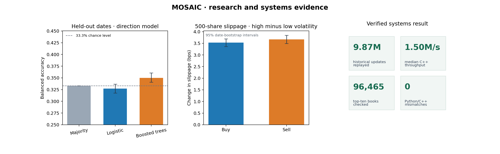
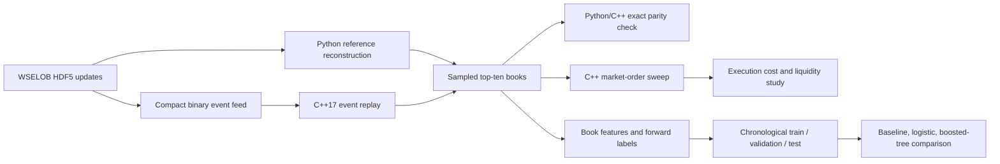

# MOSAIC

**Market Order-book Simulation, Analytics, and C++ Integration**

[](https://github.com/ArnabIITP/mosaic-orderbook/actions/workflows/ci.yml)
[](LICENSE)

MOSAIC started as a price-time-priority order-book simulator. It now includes a Python reference, a C++17 replay engine, two historical execution studies, and a small price-direction benchmark. The main question is whether displayed liquidity and recent volatility are associated with execution cost, and whether book features contain a short-horizon direction signal.

## Findings



- **Price direction:** On the final 38 trading dates, the boosted-tree model reached 35.0% balanced accuracy, compared with 33.3% for the training-prior baseline (7,364 snapshots). The improvement was 1.68 percentage points; the 95% date-bootstrap interval was 0.74–2.71 points. Log loss was slightly worse than the baseline, so this result is a small classification lift, not evidence of a usable trading signal. [Methods and full results](results/ml_direction_study.md)
- **Execution cost:** For hypothetical 500-share sweeps, high-volatility buckets had 3.53 bps more buy slippage and 3.67 bps more sell slippage than low-volatility buckets. Across 250 dates, the 95% intervals were 3.36–3.69 bps for buys and 3.49–3.84 bps for sells. The depth comparison was inconclusive: both thin-minus-deep intervals crossed zero. [WSELOB execution study](results/wselob_2017_execution_study.md)
- **Replay:** C++ processed 9.87 million updates at a median 1.50 million updates per second across three Release runs. All 96,465 sampled top-ten books matched the Python reconstruction. The timing includes feed I/O, parsing, updates, and output, so it is not a controlled Python/C++ speed comparison. [Benchmark details](results/cpp_event_replay_benchmark.json)
- **Reconstruction:** The author's reference implementation matched all 425 sampled books checked across nine dates. The `agg_volume` audit found 1,617 differences in 9.80 million checks (0.0165%); the diagnostics are recorded in the report. [Validation record](results/wselob_2017_reference_validation.json)

## What the ML experiment asks

Using one year of PEKAO data from the Warsaw Stock Exchange, the benchmark asks whether information available in a sampled book can classify the next sampled mid-price as **down, unchanged, or up** around 60 seconds later. The target is the first same-session quote at or after 60 seconds, capped at 120 seconds; the realized delay has a 79.2-second median and 114.2-second 95th percentile.

The comparison includes a majority-class baseline, regularized logistic regression, and a fixed histogram gradient-boosting model. Features use spread, bid/ask depth imbalance and scale, trailing volatility, and backward-looking returns. Dates, not individual rows, are split chronologically: 175 training dates, 37 validation dates, and 38 final test dates. Imputation and scaling are fitted on the training dates.

The target is midpoint direction, not an executable return. The benchmark does not simulate orders or account for spread, fees, queue priority, latency, or market impact.

This benchmark stops at a tree model. The data covers one instrument and uses snapshots sampled every 100 source events. Before trying a Transformer, check whether the result repeats on another stock and with finer sampling.

## What is in the project

- FIFO price-time-priority bid and ask queues; limit and market orders; cancellation; spread and depth; execution; inventory; realised and unrealised P&L.
- Python matching engine and C++17 implementation with randomized action-stream parity checks.
- WSELOB-2017 raw-feed reconstruction for add, modify, delete, retransmission, and day reset messages.
- C++ full-stream event replay and snapshot parity against the Python reconstruction.
- Historical execution sweeps at multiple order sizes, liquidity and volatility buckets, fee scenarios, delayed-book sensitivity, and date-level bootstrap intervals.
- A separate five-stock LOBSTER sample-day execution study and a controlled synthetic liquidity/volatility stress experiment.
- Time-ordered ML classification benchmark, baseline comparisons, held-out results, and date-clustered uncertainty intervals.
- Python and C++ checks plus GitHub Actions CI with AddressSanitizer and UndefinedBehaviorSanitizer on Linux.

## References

Cont, Kukanov, and Stoikov document a short-horizon relationship between order-flow imbalance, price changes, and market depth in [*The Price Impact of Order Book Events*](https://doi.org/10.1093/jjfinec/nbt003). For a richer neural-network approach to order-book prediction, see [DeepLOB](https://doi.org/10.1109/TSP.2019.2907260). MOSAIC tests a smaller feature-based benchmark on a different dataset.

## Architecture



## Reproduce the studies

### Requirements and local data

Python 3.10+, a C++17 compiler, and CMake are used. Raw market files and large row-level CSVs are intentionally not committed. Follow [data/README.md](data/README.md) to obtain the public data and place it in the expected folders. The checked-in reports, compact metrics, and summary figure show the completed results without requiring a data download.

```powershell
python -m pip install -r requirements-research.txt
```

### Run the WSELOB replay, execution study, and ML benchmark

```powershell
python -m unittest discover -v
python compare_cpp.py --events 10000 --seed 29
python replay_wselob_cpp.py --stride 100 --repetitions 3
python analyze_wselob.py --stride 100 --fee-bps 1
python ml_direction_benchmark.py
```

The WSELOB analysis writes the row-level observation CSV locally. The ML command reads that file and regenerates the ML metrics, detailed report, and README figure. The benchmark defaults to the fixed one-minute target and chronological session split described above. For an independent sampled-book comparison against the data author’s reference code:

```powershell
python -m pip install -r requirements-validation.txt
python validate_wselob_reference.py --dates 20170102 20170215 20170330 20170518 20170703 20170816 20170928 20171113 20171229 --events-per-day 5000
```

### Build and check C++ directly

```sh
cmake -S . -B build-ci -DCMAKE_BUILD_TYPE=Debug -DLOB_ENABLE_SANITIZERS=ON
cmake --build build-ci --parallel
ctest --test-dir build-ci --output-on-failure
```

## Results and data files

- [WSELOB execution study](results/wselob_2017_execution_study.md)
- [ML direction benchmark](results/ml_direction_study.md)
- [WSELOB machine-readable metrics](results/wselob_2017_metrics.json)
- [ML machine-readable metrics](results/wselob_ml_direction_metrics.json)
- [C++ raw-feed replay benchmark](results/cpp_event_replay_benchmark.json)
- [Five-stock LOBSTER execution study](results/execution_study.md)
- [LOBSTER summary metrics](results/lobster_metrics.json)
- [Data sources, licenses, and setup](data/README.md)
- [Third-party data notice](NOTICE.md)

The WSELOB study uses the PEKAO file from [Mendeley Data](https://data.mendeley.com/datasets/3g4mhdp899/1), DOI [10.17632/3g4mhdp899.1](https://doi.org/10.17632/3g4mhdp899.1), licensed CC BY 4.0. The LOBSTER files are public sample data; follow LOBSTER’s terms. Neither dataset is covered by the project’s MIT software license.

## Scope and limitations

This is historical research code, not exchange software or a live execution model. Sweeps use displayed depth and assume immediate access to it; they do not model queue position, hidden liquidity, replenishment, market impact, or network latency. The ML target is a future midpoint label, not a return from a trading strategy. The main study covers one WSE stock in 2017; the LOBSTER study covers five stocks on one day in 2012.

## License

Original project code is available under the [MIT License](LICENSE). Third-party datasets and reference materials retain their own licenses and attribution requirements; see [NOTICE.md](NOTICE.md).
